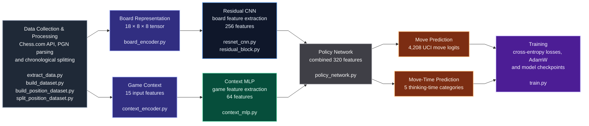

# Chess-Style-Policy-Net

A PyTorch-based chess policy network designed to learn an individual player's move choices and thinking times from historical Chess.com games. The project combines a residual convolutional neural network (CNN) with game-context features to explore how playing style changes over time.

**Status:** Early research prototype. The data processing pipeline, dual-head neural network and training infrastructure are implemented. Initial training smoke tests on real chess data have completed successfully, with full-scale training, evaluation and inference still in development.

---

## Why This Project

I started this project to explore whether a neural network could learn **how a particular person plays chess**, rather than simply predict the strongest move in a position.

A player's decisions depend on more than the board: time pressure, rating, time control and experience can all affect their choices. My longer-term goal is to investigate how well a model can imitate those decisions, particularly when the player's style and playing strength have changed over several years.

Unlike my [Chess Engine in C](https://github.com/wpimento/Chess-Engine-In-C), which searches for good moves, this project focuses on **supervised learning from moves actually played**.

---

## Features

| Category | Details |
|---|---|
| Game Collection | Scripts to download monthly game archives from the Chess.com public API |
| Data Processing | PGN parsing, game filtering, position-level training examples and Parquet storage |
| Dataset Splitting | Chronological train/validation/test split by game to prevent positions from the same game crossing splits |
| Board Encoding | 18 × 8 × 8 tensor representing pieces, side to move, castling rights and en passant |
| Context Encoding | 15 features including time control, clocks, colour, move number and ratings |
| Move Vocabulary | Fixed vocabulary of 4,208 UCI moves, including promotions |
| Neural Network | Residual CNN for board positions and MLP for game context |
| Prediction Heads | Separate outputs for move selection and five move-time categories |
| Training | PyTorch training loop with AdamW, weighted losses, missing-time masking and optional GPU acceleration |
| Checkpoints | Saves the latest model and optimiser state after each training epoch |

These features describe the **implemented code**, not a fully trained or evaluated chess-playing model.

---

## Architecture



Each training example describes the board **before a move was played**, along with information about the game. The network learns two targets:

- **Move prediction:** Which move the player actually made, encoded using a fixed UCI move vocabulary.
- **Move-time prediction:** Approximately how long the player spent thinking, grouped into five buckets: under 0.3 seconds, 0.3-1 seconds, 1-3 seconds, 3-8 seconds and 8+ seconds.

Both heads are trained using cross-entropy loss. The move-time loss is masked when a usable time target is unavailable.

---

## Setup

### Prerequisites

- Python **3.11** (recommended)
- pip
- Internet access to download Chess.com game archives
- Optional: an NVIDIA GPU with a compatible PyTorch/CUDA installation

### Installation

From the repository root, on Windows PowerShell:

```powershell
py -3.11 -m venv .venv
.venv\Scripts\Activate.ps1
python -m pip install --upgrade pip
python -m pip install -r requirements.txt
```

On Linux or macOS, create and activate the environment using `python3.11 -m venv .venv` and `source .venv/bin/activate`, then run the same pip commands.

**Note:** The repository contains a `requirements-cuda.txt` for an experimental CUDA-specific installation; check compatibility with your GPU and drivers before using it.

---

## Usage

### Data Collection and Processing

First, configure the Chess.com usernames in [src/config.py](src/config.py).

Run the following scripts from the repository root:

```bash
python src/extract_data.py
python src/build_dataset.py
python src/build_position_dataset.py
python src/split_position_dataset.py
```

These scripts download and process games, extract individual chess positions and their corresponding move targets and divide the data chronologically into training, validation and test sets.

The generated datasets are stored locally under `data/` and are excluded from version control.

**Note:** The complete data pipeline has not yet been tested end to end and may require further fixes for incomplete game records or missing clock information.

### Training and Optimisation

The training loop is implemented in [src/train.py](src/train.py).

```bash
python src/train.py
```

The training process uses a combined loss for move prediction and thinking-time classification, with optional GPU acceleration.

Model and optimiser checkpoints are saved to `models/latest_policy_net.pt` after each epoch.

Training is still experimental. Checkpoint resuming, validation metrics and model evaluation have not yet been implemented.

---

## Configuration

- [src/config.py](src/config.py): Chess.com account usernames.
- [src/train.py](src/train.py): Epoch count, learning rate, batch size, weight decay and the relative weight of the move-time loss.
- [src/split_position_dataset.py](src/split_position_dataset.py): Chronological train/validation/test ratios.
- [src/build_position_dataset.py](src/build_position_dataset.py): Move-time bucket definitions and position target extraction.

---

## Roadmap

The neural network has passed synthetic-input forward-pass and backpropagation tests, alongside an initial training smoke test using real chess positions. The training pipeline can successfully process batches, update model weights and save checkpoints, although full training and evaluation are still in development.

- [x] Implement data preprocessing and generate a training dataset from real Chess.com games
- [x] Verify model outputs and backpropagation with automated smoke tests
- [x] Complete an initial GPU training smoke test using real chess positions
- [ ] Add automated tests for move encoding, clock annotations and chronological splits
- [ ] Review numerical feature scaling and missing input values
- [ ] Train a baseline model and evaluate move top-k accuracy and move-time classification
- [ ] Add checkpoint loading, legal-move masking and inference/sampling
- [ ] Compare all-history, recent-only and fine-tuned models to investigate changes in playing style

More detailed research plans and experimental ideas are documented in [docs/notes.md](docs/notes.md).

## Results

**No trained-model accuracy or behavioural imitation results are available yet.** Evaluation will be added after the training and validation pipeline has been tested end to end.

## Contributing

This is a personal learning and research project. Feel free to explore or fork it; the implementation is still changing.

## License

This project is licensed under the [MIT License](LICENSE).